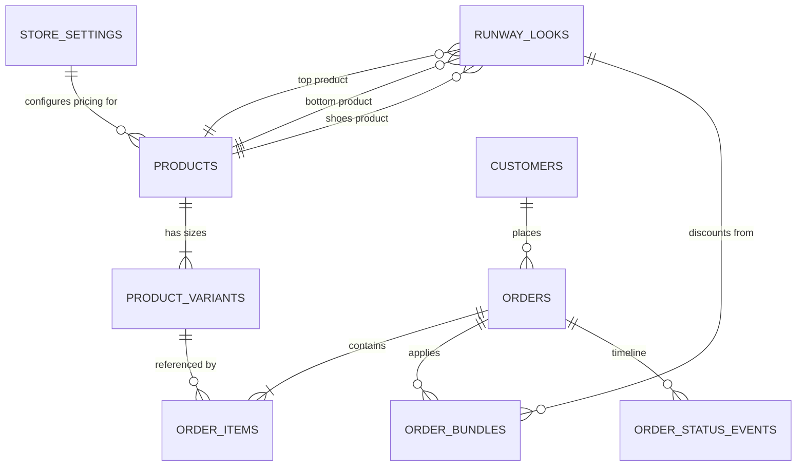

# DATABASE.md — Our Database Schema, In Simple Terms

This document explains how the data for the Runway store is structured: the main
tables, what goes in each one, and how they connect to each other.

> For how the application itself is built (files, pages, routing), see
> **[ARCHITECTURE.md](./ARCHITECTURE.md)**.

---

## 1. Where Data Lives Right Now

Today there is **no real database yet**. Each "store" in the code saves its data as
JSON in the browser's `localStorage`:

| Data | Code file | localStorage key |
|---|---|---|
| Products & stock | `src/products-store.ts` | `runway-managed-products-v1` |
| Runway looks | `src/products-store.ts` | `runway-managed-looks-v1` |
| Orders | `src/orders-store.ts` | `runway-orders-v1` |
| Store settings | `src/store-config.ts` | `runway-store-config-v1` |
| Shopping bag (cart) | `src/pages/cart-page.ts` | `runway-styling-bag-v3` |

That works fine for a demo, but it is **per-browser** — data doesn't sync between
the shopper and the store owner. The good news: the TypeScript interfaces in those
files (`ManagedProduct`, `Order`, `StoreConfig`, …) are already shaped exactly like
database tables. So the schema below is basically *those interfaces, normalized*.

---

## 2. The Main Tables (8 of them)

Think of the database as one settings sheet, one catalog, one runway plan, and the
sales story:

```
                        ┌──────────────────┐
                        │  store_settings  │  ← 1 row: brand info, fees, discounts
                        └──────────────────┘
                                  │ (its rules apply to everything below)
                                  ▼
     CATALOG                 RUNWAY                     SALES
┌────────────────┐   ┌──────────────────┐   ┌────────────────────────────┐
│    products    │   │  runway_looks    │   │         customers          │
│  (garments,    │◄──┤  (Look 01..12,   │   │  (name, phone, GPS pin)    │
│   shoes, tech) │   │   which items    │   └──────────┬─────────────────┘
└───────┬────────┘   │   form the fit)  │              │ places
        │ has        └────────┬─────────┘              ▼
        ▼                     │ showcases     ┌─────────────────┐
┌────────────────┐            └──────────────►│     orders      │
│product_variants│                           │ (RNW-1042, MoMo,│
│ (SKU per size) │────────────────┐          │  status, totals)│
└────────────────┘                │          └───┬─────────┬───┘
        ▲                         │              │         │
        │ references              │              ▼         ▼
        │                  ┌──────┴──────┐ ┌──────────┐ ┌──────────────┐
        └──────────────────┤ order_items │ │  order_  │ │order_status_ │
                           │ (what was   │ │ bundles  │ │   events     │
                           │  bought)    │ │(look dis-│ │(status histo-│
                           └─────────────┘ │  counts) │ │  ry / track) │
                                           └──────────┘ └──────────────┘
```

**In one sentence:** the store settings configure everything; products and variants
form the catalog; runway looks pick products from that catalog to build outfits;
customers place orders; orders contain items (which point at variants), may get
bundle discounts (which point at looks), and have a status history for tracking.

---

## 3. Table-by-Table Breakdown

### 1) `store_settings` — one row, the boss
Everything the owner configures in the Admin → Settings page.

| Field | Example |
|---|---|
| `brand_name`, `brand_tagline`, `instagram_handle` | "Around Clothing" |
| `pickup_address` | "Oxford Street, Osu Atelier Hub, Accra" |
| `momo_number`, `momo_account_name` | "024 555 0192" |
| `runway_display_mode` | 1 = single item, 2 = duo, 3 = full outfit |
| `default_bundle_discount_percent` | 10 |
| `per_look_bundle_discounts` | `{ "1": 15 }` (override per look, JSON) |
| `charge_delivery_fee`, `delivery_fee_ghs` | true, 35 |
| `free_delivery_threshold_ghs` | 1200 |
| `currency_code`, `tax_rate_percent` | "GHS", 0 |

### 2) `products` — the catalog
One row per sellable item (shirt, pants, shoes, bag, even a MacBook).

| Field | Example |
|---|---|
| `id` (PK) | `fit-1-shirt` |
| `name`, `category`, `vendor` | "Charcoal Heavy Knit Crew", Apparel |
| `cost_price_ghs` | 121 (what we pay — used for profit math) |
| `selling_price_ghs` | 289 (what the customer pays) |
| `stock_quantity` | 24 |
| `image` | `/assets/fit-1-shirt.webp` |
| `specs` (JSON) | `{"material": "wool", "fit": "relaxed"}` |
| `has_sizes` | true (false for one-size / tech items) |

### 3) `product_variants` — one row per size (the actual SKU)
This is what actually goes in a cart. Keeps stock per size.

| Field | Example |
|---|---|
| `id` (PK) | `920110441` |
| `product_id` (FK → products) | `fit-1-shirt` |
| `size` | "M" |
| `price_ghs` | 289 |
| `stock_quantity` | 6 |

### 4) `runway_looks` — the outfits on the 3D stage
One row per look (up to 12). A look points at 1–3 products depending on its mode.

| Field | Example |
|---|---|
| `id` (PK) | 1 |
| `look_num`, `name`, `description` | "01", "Gallery Opening", … |
| `model_image` | `/assets/fit-1-model.webp` |
| `mode` | 1 / 2 / 3 (how many pieces are pinned) |
| `top_product_id` (FK → products) | `fit-1-shirt` |
| `bottom_product_id` (FK → products, optional) | `fit-1-pants` |
| `shoes_product_id` (FK → products, optional) | `fit-1-shoes` |
| `active_on_runway` | true / false |

*(In a fully normalized database, the three product FKs could also become a
`look_items` join table — the current design keeps it simple because a look never
has more than 3 slots.)*

### 5) `customers` — who is buying
Extracted from the checkout form (today it is embedded inside each order).

| Field | Example |
|---|---|
| `id` (PK) | uuid |
| `full_name`, `phone`, `email` | "Ama Serwaa Boateng", "024 555 0182" |
| `street`, `city`, `country` | "GPS: 5.5632, -0.1836", "East Legon, Accra" |
| `latitude`, `longitude` | GPS pin from the 1-click location button |
| `preferred_fulfillment` | "delivery" or "pickup" |

### 6) `orders` — one row per purchase
Created by `createOrder()` at checkout; managed in the Admin desk; tracked on the
track page.

| Field | Example |
|---|---|
| `id` (PK) | `RNW-1042` |
| `customer_id` (FK → customers) | uuid |
| `created_at` | 2026-11-16 09:30 |
| `status` | Processing → Shipped → In Transit → Out for Delivery → Delivered (or Ready for Pickup → Collected, or Cancelled) |
| `payment_method` | "Mobile Money (MTN MoMo)" |
| `subtotal`, `shipping`, `tax`, `total` | 28.9, 0, 0, 28.9 |

### 7) `order_items` — the line items of an order
What was actually bought, at which size and price (price is copied here so old
orders stay correct even if prices change later).

| Field | Example |
|---|---|
| `id` (PK) | auto |
| `order_id` (FK → orders) | `RNW-1042` |
| `variant_id` (FK → product_variants) | `920110441` |
| `product_name` (snapshot) | "Charcoal Heavy Knit Crew" |
| `size` (snapshot) | "M" |
| `unit_price_ghs` (snapshot) | 28.9 |
| `quantity` | 1 |

### 8) `order_bundles` — discounts that were applied
When the bundle engine (`src/bundle-store.ts`) detects a full look in the cart,
the discount is recorded here so receipts and reports stay honest.

| Field | Example |
|---|---|
| `id` (PK) | auto |
| `order_id` (FK → orders) | `RNW-1017` |
| `look_id` (FK → runway_looks) | 2 |
| `bundle_name` (snapshot) | "Look 02 — Gallery Opening" |
| `discount_percent` | 10 |
| `discount_amount_ghs` | 4.08 |

### 9) `order_status_events` (optional but recommended) — the tracking timeline
One row every time the status changes; this is what powers the track page timeline
and the courier map.

| Field | Example |
|---|---|
| `id` (PK) | auto |
| `order_id` (FK → orders) | `RNW-0984` |
| `status` | "Shipped" |
| `note` | "Handed to courier at Osu hub" |
| `created_at` | 2026-11-15 16:02 |

---

## 4. How the Tables Connect (the relationships, plainly)

| Relationship | In plain English |
|---|---|
| `store_settings` → everything | It has no foreign keys; its *rules* (fees, discounts, currency) are applied when orders and carts are calculated. |
| `products` **1 → many** `product_variants` | A shirt is one product; "shirt size M" is a variant. |
| `runway_looks` **→** `products` | A look picks 1–3 products from the catalog to dress the model. |
| `customers` **1 → many** `orders` | One person can place many orders. |
| `orders` **1 → many** `order_items` | An order lists everything bought. |
| `product_variants` **1 → many** `order_items` | Each line item points at one size-SKU. |
| `orders` **1 → many** `order_bundles` | An order can contain several detected bundles. |
| `runway_looks` **1 → many** `order_bundles` | Records *which look* the discount came from. |
| `orders` **1 → many** `order_status_events` | The Processing → Delivered timeline. |

### The same thing as an ER diagram



---

## 5. Worked Example — One Order Walking Through the Tables

Ama buys the full **Look 01** outfit (shirt + pants + shoes):

1. **`customers`** — a row is saved: *Ama Serwaa Boateng*, phone, GPS pin.
2. **`orders`** — a row is created: `RNW-1043`, status `Processing`, MoMo.
3. **`order_items`** — 3 rows: shirt size M, pants size 32, shoes size 40 — each
   pointing at its `product_variants` SKU, with prices snapshotted.
4. **`order_bundles`** — the bundle engine sees all 3 pieces of Look 01 → 1 row:
   10% off, linked to `runway_looks.id = 1`.
5. **`order_status_events`** — a `Processing` row; the admin later appends
   `Shipped`, `In Transit`, `Delivered` — each appearing instantly on the
   customer's track page.

---

## 6. Upgrading to a Real Database Later

The code was deliberately structured for this moment:

- Every store already exposes simple functions (`getOrders()`, `saveOrders()`,
  `getManagedProducts()`, `getStoreConfig()`).
- `src/store-config.ts` already defines a **`StoreConfigRepository` interface** with
  a localStorage implementation (`LocalStorageStoreConfigRepository`) — the same
  pattern applies to the other stores.
- So moving to **PostgreSQL / Supabase / Firebase** means: keep the table shapes
  from this document, implement repository classes that call the API instead of
  `localStorage`, and *zero page components need to change*.

See [docs/STORE_CONFIG_AND_DATABASE_CONTRACT.md](./docs/STORE_CONFIG_AND_DATABASE_CONTRACT.md)
for the full technical contract, and
[docs/CONCEPTUAL_DATABASE_SCHEMA_AND_ARCHITECTURE.md](./docs/CONCEPTUAL_DATABASE_SCHEMA_AND_ARCHITECTURE.md)
for the long-form version of this schema.
