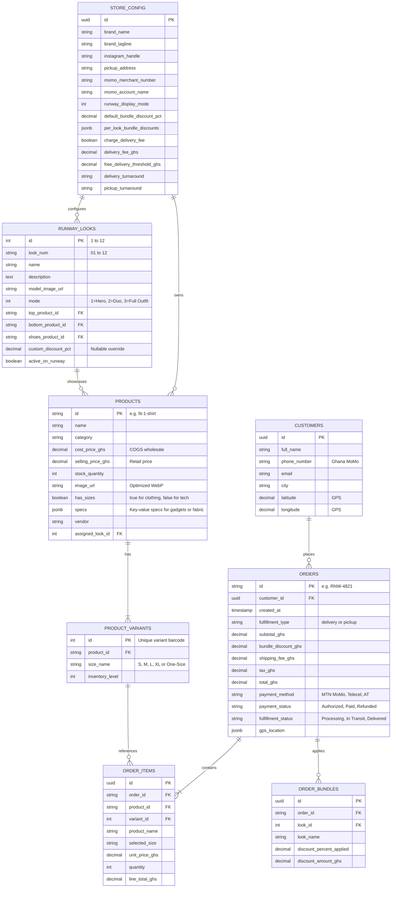

# Runway Digital Showroom: Architecture & Conceptual Database Schema

> **Document Goal**: Explain what we are building, how every piece of the application works together, and how the data is structured in a database—written in simple, plain English so anyone on the team (founders, designers, developers, and business stakeholders) can easily understand it.

---

## Part 1: What Are We Building? (The Big Picture)

Most fashion and luxury boutique websites in Africa look like standard, boring catalogs with hundreds of endless grids. 

We built **Runway**: an interactive **3D Digital Showroom & Atelier Operations Platform** specifically crafted for modern African fashion brands (like *Around Clothing*, *1981 Clothings*, and *MOD HQ*).

### What makes it special?
1. **The 3D Interactive Runway**: Instead of scrolling down a boring page, shoppers step into a virtual fashion show. They can spin through **up to 12 curated looks** on a circular stage with real 3D depth, perspective scaling, and dynamic atmospheric lighting.
2. **Flexible Presentation Modes (Not Just Clothing)**:
   - **Mode 1 (Single Hero)**: Perfect for solo showcase items (a luxury trench coat, a designer handbag, or even tech products like an Apple MacBook Pro). No clothing pins; shoppers click the item to see full technical specs.
   - **Mode 2 (Duo Combo)**: 2-piece pairing (e.g., Top + Pants, or Watch + Sunglasses).
   - **Mode 3 (Full Outfit)**: Complete 3-piece collection (Top + Pants + Footwear).
3. **Smart Look Bundle Engine**: When a shopper adds all pieces of an outfit to their bag, the system detects it and instantly gives them a **Look Bundle Discount** (e.g., 10% or 15% off).
4. **Ghanaian Logistics & Mobile Money (MoMo)**:
   - Built-in 1-Click GPS pin detection that calculates real Accra road distances.
   - Transparent delivery fees (e.g., GH₵ 35 doorstep courier, or FREE delivery if the shopper spends over GH₵ 1,200).
   - Instant Mobile Money checkout prompt simulation (MTN MoMo, Telecel Cash, AT Money).
5. **The Atelier Admin Operations Desk**: A complete private back-office where store owners can track orders, update inventory prices, compress images automatically to WebP, customize discounts, and manage delivery fees.

---

## Part 2: Application Architecture Explained Simply

Think of the application like a high-end fashion boutique on Oxford Street, Osu:

```
┌────────────────────────────────────────────────────────────────────────┐
│                        1. THE SHOWROOM (FRONTEND)                      │
│                                                                        │
│   [ 3D Runway Stage ]     [ Shopping Cart ]     [ Express Checkout ]   │
│   Shoppers browse,        Items gather,         GPS pin locks address, │
│   spin models, view specs discounts compute     MoMo wallet prompts    │
└───────────────────────────────────▲────────────────────────────────────┘
                                    │
                                    │ (Data flows back and forth)
                                    ▼
┌────────────────────────────────────────────────────────────────────────┐
│                   2. THE ENGINE & BRAIN (BUSINESS LOGIC)               │
│                                                                        │
│   • Bundle Analyzer: "Did customer pick all 3 items from Look 01?"     │
│   • Shipping Calculator: "Is order over GH₵ 1,200? If yes, free!"     │
│   • Image Optimizer: "Shrink photos to fast WebP without losing alpha" │
└───────────────────────────────────▲────────────────────────────────────┘
                                    │
                                    │ (Clean Contract Interface)
                                    ▼
┌────────────────────────────────────────────────────────────────────────┐
│                  3. THE VAULT (DATABASE & STORAGE LAYER)               │
│                                                                        │
│   [ Store Settings ]   [ Products & SKUs ]   [ Runway Looks 01-12 ]    │
│   [ Customer Orders ]  [ Order Items ]       [ Delivery Addresses ]    │
└───────────────────────────────────▲────────────────────────────────────┘
                                    │
                                    │ (Store Owner Controls)
                                    ▼
┌────────────────────────────────────────────────────────────────────────┐
│                  4. THE BACK OFFICE (ATELIER ADMIN DESK)               │
│                                                                        │
│   • Financial KPI Cards (Gross Revenue, Net Profit, Margins)           │
│   • Garments & Wholesale Cost Pricing                                 │
│   • Order Stream & Status Workflow (Processing -> Shipped -> Delivered)│
│   • Store Settings & Per-Look Bundle Overrides                         │
└────────────────────────────────────────────────────────────────────────┘
```

### The 4 Layers in Plain English

1. **The Showroom (Presentation)**: Everything the customer touches. Built with responsive web components that run at 60 frames per second on both smartphones and desktops.
2. **The Brain (Business Rules)**: The math and logic. It calculates margins, checks if a cart qualifies for free shipping, ensures discounts don't exceed 100%, and matches matching tops, bottoms, and shoes into bundles.
3. **The Vault (Database Contract)**: The single source of truth. We designed this with a **Repository Pattern**. Today, it saves smoothly into browser memory. When we connect a real database (PostgreSQL, Supabase, or Firebase), we just plug the database cable into this vault—**we don't need to rebuild any screens**.
4. **The Back Office (Admin Desk)**: Where the brand owner runs their business without touching a line of code.

---

## Part 3: The Conceptual Database Schema

If you open up a relational database like PostgreSQL or Supabase, here is how the tables talk to each other:



---

## Part 4: Detailed Breakdown of Each Table

### 1. `store_config` (The Brand Master Table)
* **What it does**: Stores the store settings that control how the entire shop behaves.
* **Key Columns**:
  - `brand_name`: "Around Clothing"
  - `momo_merchant_number`: The phone number customer payments go to.
  - `runway_display_mode`: Controls whether the stage displays Solo Hero (1), Duo (2), or Full Outfit (3).
  - `default_bundle_discount_pct`: Global discount rate (e.g. 10%).
  - `per_look_bundle_discounts`: A JSON map (e.g. `{"1": 15, "3": 20}`) for custom discounts on specific looks.
  - `charge_delivery_fee`: True/False toggle. If False, storewide shipping is free.
  - `delivery_fee_ghs`: Standard courier fee (e.g. GH₵ 35.00).
  - `free_delivery_threshold_ghs`: Threshold where courier becomes free (e.g. GH₵ 1,200.00).

### 2. `products` (Garments & Catalog)
* **What it does**: Holds every single piece of clothing, accessory, or gadget.
* **Key Columns**:
  - `id`: Unique identifier (e.g. `fit-1-shirt`, `tech-macbook-pro-16`).
  - `cost_price_ghs`: What it cost to tailor or produce (used by the Admin Desk to calculate net profit).
  - `selling_price_ghs`: What the customer pays.
  - `has_sizes`: Set to `false` for tech gadgets, hats, or one-size items so customers aren't prompted to pick S/M/L.
  - `specs`: A flexible JSON blob for technical specs (e.g., `{"Processor": "M3 Max", "RAM": "36GB"}` or `{"Fabric": "100% Heavy French Terry Cotton", "GSM": "450"}`).

### 3. `runway_looks` (The 12 Runway Stages)
* **What it does**: Defines what appears on the 12 runway spots on the 3D rotating stage.
* **Key Columns**:
  - `id`: Slot number (1 to 12).
  - `mode`: 1 (Single Hero), 2 (Duo), 3 (Full Outfit).
  - `top_product_id`: The hero piece.
  - `bottom_product_id`: The pants/skirt (used in modes 2 & 3).
  - `shoes_product_id`: The footwear (used in mode 3).
  - `custom_discount_pct`: Optional override if this specific look has a special promo rate.

### 4. `orders` & `order_items` (Customer Transactions)
* **What it does**: Records every order made via the checkout.
* **Key Columns**:
  - `id`: Human-readable invoice number (e.g. `RNW-7812`).
  - `fulfillment_type`: Either `delivery` (courier sends to GPS pin) or `pickup` (shopper collects at Osu Flagship).
  - `shipping_fee_ghs`: Dynamically calculated (GH₵ 0 for pickup, GH₵ 0 if above threshold, GH₵ 35 for standard courier).
  - `payment_method`: MTN MoMo, Telecel Cash, or AT Money.
  - `fulfillment_status`: Processing -> In Transit -> Delivered.

---

## Part 5: How Data Moves in Real-Life Scenarios

### Scenario A: Customer Ama Mensah buys Look 01 in Accra
1. **Browse**: Ama spins the 3D Runway to Look 01 ("The City Edit").
2. **Add to Bag**: She clicks Pin 1 (Shirt, Size M), Pin 2 (Pants, Size 32), and Pin 3 (Shoes, Size 43).
3. **Bundle Detection**: The Bundle Analyzer sees all 3 items from Look 01 are in her bag. It checks `store_config`:
   - Look 01 has a **15% custom override**.
   - It deducts GH₵ 367.50 automatically!
4. **Checkout & GPS**: Ama clicks Proceed to Checkout. She taps **"1-Click GPS Pin"**. The system contacts GPS and measures 4.8 km from the Osu Flagship.
5. **Shipping Calculation**:
   - Ama's subtotal is GH₵ 2,082.50.
   - Because GH₵ 2,082.50 is greater than the GH₵ 1,200 free delivery threshold, the system displays: **`FREE DELIVERY (Orders over GH₵ 1,200)`**.
6. **Payment**: Ama types her phone number (`024 555 1234`). The system auto-detects **MTN MoMo**, displays the *170# USSD prompt simulation, and saves order `RNW-3921`.
7. **Admin Dispatch**: Store owner Kwesi opens the Admin Desk, sees Ama's order at the top, clicks the status dropdown, and moves it to **"In Transit"**.

### Scenario B: A Tech Merchant uses the platform for Laptops
1. Store owner switches runway display mode to **Mode 1 (Single Hero)** in Admin.
2. They add a **MacBook Pro 16"** with `hasSizes: false` and JSON specs (`M3 Max`, `1TB SSD`).
3. On the storefront:
   - The stage removes the clothing pins.
   - An ambient underlight illuminates the product.
   - When shoppers click the laptop, size selection is hidden, and the full technical spec sheet renders crisply.

---

## Part 6: How We Connect This to Supabase or PostgreSQL

Connecting this frontend to a real remote database is completely straightforward because of the **Repository Pattern** we implemented in [`src/store-config.ts`](../src/store-config.ts):

```typescript
// 1. Install Supabase client: npm install @supabase/supabase-js
import { createClient } from '@supabase/supabase-js';
import { StoreConfig, StoreConfigRepository, setStoreConfigRepository } from './store-config';

const supabase = createClient('https://xyz.supabase.co', 'public-anon-key');

export class SupabaseStoreRepository implements StoreConfigRepository {
  private configCache: StoreConfig;

  async init() {
    const { data } = await supabase.from('store_config').select('*').single();
    if (data) this.configCache = data;
  }

  getConfig(): StoreConfig {
    return this.configCache;
  }

  async saveConfig(config: StoreConfig): Promise<void> {
    this.configCache = config;
    await supabase.from('store_config').upsert({ id: 'primary-store', ...config });
  }
}

// 2. Set the repository when the app boots:
// setStoreConfigRepository(new SupabaseStoreRepository());
```

Because all views (Runway, Cart, Checkout, Admin) call `getStoreConfig()` and `updateStoreConfig()`, **not a single line of UI code needs to be changed** when moving to a live production database.

