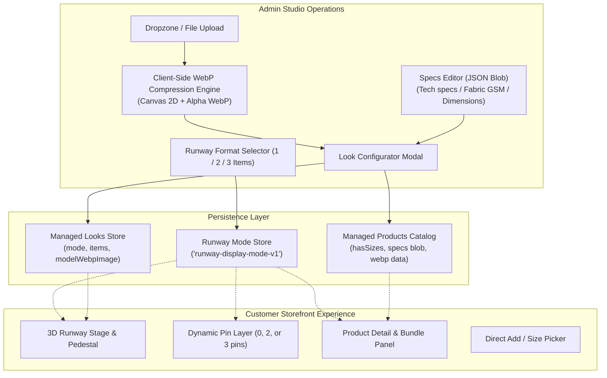
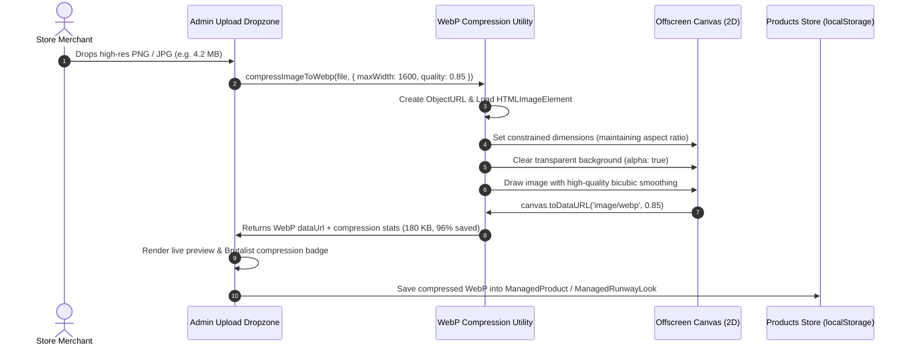

# Architecture Specification: Flexible Runway Engine & WebP Compression Pipeline

**Document Status:** Approved for Implementation  
**Audience:** Technical Team & Store Operators  
**System Target:** Accra Digital Runway Commerce Engine (`/src`)

---

## 1. Executive Summary & Problem Definition

The 3D interactive runway is the signature conversion engine of this storefront. However, merchant requirements vary across product categories:
1. **Fashion Boutiques:** Require full 3-piece looks (Top + Bottom + Footwear) with interactive pins `1, 2, 3` and bundle discounts.
2. **Tech & Electronics (e.g., MacBook Pro, Audio, Flagship Gadgets):** Feature standalone showcase items with no clothing sizes and transparent background cutouts floating on a stage pedestal. Numbered pins `1, 2, 3` are completely irrelevant and distracting.
3. **Coordinated Sets / Duos (e.g., 2-Piece Loungewear, Sunglasses + Bag):** Require exactly 2 items with 2 pins and 2-piece package pricing.

### The Visual Continuity Mandate
> **Strict Flow Rule:** A customer must never see a 3-piece outfit in Look 01, and then an isolated bag with 2 empty missing garment slots in Look 02. The visual flow must remain homogeneous and deliberate across the active runway.

To maintain editorial elegance:
* The store enforces a **Runway Display Format** (`1` Hero, `2` Duo, or `3` Full Outfit).
* In the Admin Studio, slots strictly enforce that all required items for the chosen format are configured (no empty slots permitted).
* All uploaded images are compressed client-side to **modern WebP with alpha transparency preserved**, minimizing mobile data consumption across Ghanaian cellular networks (MTN, Telecel) while keeping load times under 800ms.

---

## 2. System Architecture & Component Mapping



---

## 3. Runway Display Modes & Stage Mechanics

### Mode 1: Single Hero Showcase (1 Item)
* **Target Categories:** Tech hardware (MacBook Pro, iPad), luxury timepieces, solitary streetwear drop, designer bag, bespoke art piece.
* **Stage Geometry:**
  * **Pin Dots (`1, 2, 3`):** **Suppressed completely (`display: none`).** No floating circular badges or numbers.
  * **Hero Visual:** Cutout image (transparent WebP) floats over the runway stage pedestal. An ambient radial under-shadow (`.rw__art--hero-single::after`) grounds the product.
  * **Click Action:** Clicking directly anywhere on the floating product opens the product drawer / detail sheet.
* **Side Panel Layout:**
  * Header label: "FEATURED HERO" or Category badge (replaces "3 pieces").
  * Shows exactly 1 product card with no number badge (`.rw__num` hidden).
  * Bundle box: Suppressed. Replaced by a high-prominence direct CTA: `Add to Bag — GH₵ [Price]`.
* **Sizing & Specs:**
  * If `hasSizes === false` (e.g. MacBook Pro), size pill selector is omitted. Direct single-tap add to bag.
  * Product Specifications JSON blob is formatted into a clean neo-brutalist key-value table.

### Mode 2: Duo Combo (2 Items)
* **Target Categories:** Matching two-piece tracksuits, sunglasses + bag combo, top + bottom matching set.
* **Stage Geometry:**
  * Shows pins `1` and `2`. Pin `3` is hidden.
* **Side Panel Layout:**
  * Header label: "2 PIECES".
  * Shows exactly 2 product cards.
  * Bundle box calculates a 2-piece set discount (e.g. 10% off the duo).

### Mode 3: Full Runway Outfit (3 Items — Default)
* **Target Categories:** Head-to-toe high-fashion editorial styling (Top + Bottom + Footwear).
* **Stage Geometry:**
  * Shows all 3 interactive pins (`1`, `2`, `3`).
* **Side Panel Layout:**
  * Header label: "3 PIECES".
  * Shows all 3 product cards.
  * Bundle box calculates 3-piece complete look discount.

---

## 4. Product Metadata & Arbitrary Specs JSON Blob

Different product verticals require different specifications. A clothing item needs GSM and fabric composition; a laptop needs processor, RAM, and SSD storage.

### Data Model Schema

```typescript
export interface ManagedProduct {
  id: string;
  name: string;
  category: string;
  costPriceGhs: number;
  sellingPriceGhs: number;
  stockQuantity: number;
  image: string;
  
  // Sizing Flexibility
  sizes: string[];                // Empty [] when product has no sizes
  hasSizes?: boolean;             // false for tech / one-size / accessories
  
  // Dynamic Specifications JSON Blob
  specs?: Record<string, string>; // Arbitrary key-value pairs
  description?: string;
  vendor: string;
  assignedLookId?: number;
}
```

### JSON Spec Examples by Category

#### Tech Hardware (e.g., MacBook Pro)
```json
{
  "Processor": "Apple M3 Pro (12-Core CPU, 18-Core GPU)",
  "Memory": "18GB Unified Memory",
  "Storage": "512GB Ultra-Fast SSD",
  "Display": "14.2-inch Liquid Retina XDR (120Hz ProMotion)",
  "Battery Life": "Up to 18 hours wireless web",
  "Ports": "3x Thunderbolt 4, HDMI, SDXC, MagSafe 3"
}
```

#### Fashion Streetwear (e.g., Charcoal Heavyweight Crew)
```json
{
  "Fabric": "100% Combed Heavyweight Organic Cotton",
  "Weight": "380 GSM Pre-Shrunk Fleece",
  "Fit": "Boxy Drop-Shoulder Relaxed Cut",
  "Origin": "Kaneshie Tailoring District, Accra",
  "Care": "Cold machine wash inside out, flat dry"
}
```

#### Footwear / Accessories
```json
{
  "Upper": "Premium Full-Grain Leather & Breathable Mesh",
  "Midsole": "Kinetic Air-Cushioned EVA Foam",
  "Outsole": "High-Traction Vulcanized Rubber",
  "Weight": "385g per shoe"
}
```

---

## 5. Client-Side WebP Compression Pipeline

### Compression Flowchart



### Key Technical Specifications

1. **Alpha Channel Transparency:**
   * When canvas context is created with `{ alpha: true }`, any cutout background remains 100% transparent in the WebP output.
   * Enables seamless floating pedestals on the 3D stage.
2. **Dimension Constraints:**
   * Runway Stage Models / Cutouts: Max `1600px` width, `2400px` height.
   * Product Item Thumbnails: Max `900px` width, `1200px` height.
3. **Quality & Performance:**
   * WebP compression factor: `0.85`.
   * Result: Typical 3MB–8MB camera/phone upload shrinks to **120KB–240KB** without visible compression artifacts.
   * Load time on 3G/4G networks drops from ~4.5s to **< 350ms**.
4. **Fallback Safety:**
   * If an older browser does not support `image/webp` canvas export, the engine gracefully falls back to `image/png` to preserve alpha transparency.
   * In non-DOM unit test environments (`tsx --test`), the function safely returns fallback metadata without crashing.

---

## 6. Implementation Changeset

| Module | Scope of Modification |
|---|---|
| `src/utils/image-compression.ts` | **NEW:** Client-side WebP compression engine, byte formatting, aspect ratio resizer, compression statistics calculator. |
| `src/products-store.ts` | **UPDATED:** Added `RunwayDisplayMode` (`1 \| 2 \| 3`), `getRunwayDisplayMode()`, `setRunwayDisplayMode()`, `hasSizes` & `specs` fields on `ManagedProduct`, `mode` on `ManagedRunwayLook`, flexible look configurator with validation. |
| `src/pages/admin-page.ts` | **UPDATED:** Added Runway Mode Selector at top of Products & Settings. Added interactive WebP drag & drop uploaders with live savings pill. Added optional sizing toggle and JSON specs editor. Enforced slot completeness based on active mode. |
| `src/runway-section.ts` | **UPDATED:** Subscribed to `runway:mode-updated`. Mode 1 suppresses pin dots, makes stage hero directly clickable to open product details, adapts side panel to single item with specs table. Mode 2 adapts to 2 pins and duo discount. Mode 3 retains full outfit. |
| `src/index.css` | **UPDATED:** Added neo-brutalist styles for WebP dropzone, compression badge, single-hero pedestal ambient light, and specs table. |

---

## 7. Verification & Quality Gates

1. **Unit Testing:** `npm test` must run all 19 existing tests + new compression and mode tests with 100% pass rate.
2. **TypeScript Compilation:** `npx tsc --noEmit` must output 0 errors.
3. **Production Build:** `npm run build` must bundle HTML, CSS, and JS cleanly.
4. **Interactive Verification:**
   * Switching between Mode 1, 2, and 3 updates both Admin UI and Customer Storefront in real-time.
   * Dragging a 4MB PNG into the uploader shows instant WebP compression with transparent alpha preserved.

